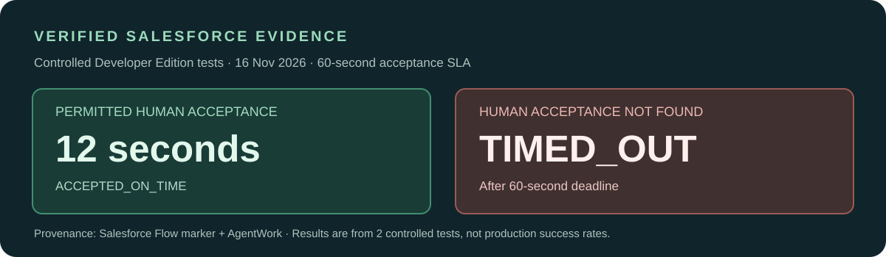

# HandoffGuard

**An AI saying "I'll transfer you" is not proof that a human accepted the conversation.**

HandoffGuard is an independent Java 21 reliability-verification project for Salesforce Agentforce and Omni-Channel. It correlates **actual Flow-captured escalation timestamps** with **AgentWork human acceptance** to classify whether a handoff met a 60-second target. It also includes a clearly separated deterministic simulator with six retail support scenarios.

> Independent portfolio project. Not an official Salesforce product. Never claim simulated measurements as production latency. All Salesforce data shown in this README is from controlled Developer Edition tests.

## Live demo and architecture

**Architecture diagram:** [View the system flow and trust boundaries](docs/ARCHITECTURE.md) · **Release notes:** [v1.0.0](docs/RELEASE_v1.0.0.md) · **Verification checklist:** [Evidence-backed v1.0 results](docs/V1_RELEASE_CHECKLIST.md)

- Public simulator: https://handoffguard-614664795142.asia-south1.run.app
- Local-only evidence viewer: https://handoffguard-614664795142.asia-south1.run.app/history (import a JSON snapshot you download from private Google Cloud Storage)
- GitHub Actions: [Java 21 CI](.github/workflows/ci.yml)
- Deployment: Docker on Google Cloud Run, region `asia-south1`
- Private Salesforce integration: OAuth client credentials, read-only SOQL, Cloud Secret Manager for keys

```text
Customer → Salesforce Agentforce → Omni-Channel escalation Flow
                                          │
                          Flow writes HandoffGuardTransfer__c
                          (MessagingSession ID + CurrentDateTime)
                                          │
                      Salesforce AgentWork records human acceptance
                                          │
                                          ▼
                         HandoffGuard Java verifier (private API)
                             ├─ 60-second SLO verdict
                             ├─ human-identity allowlist
                             ├─ 15/18-char Salesforce ID correlation
                             ├─ missing / late / pending outcomes
                             └─ provenance labels
                                          │
                      Cloud Run Job (optional) → private GCS snapshots
                                ▲                         │
                        Cloud Scheduler              /history viewer
```

## Verified outcomes at a glance



This **rendered summary** is based on the real audit snapshot; it is not a raw Salesforce screenshot. For source-based media capture guidance, see [Demo walkthrough](docs/DEMO_WALKTHROUGH.md).

## Verified Salesforce evidence

A controlled Developer Edition test created an actual Flow audit marker:

- Messaging Session: `0Mwg7000002Y2cX` (15-character Flow value; Salesforce REST may use 18 characters)
- Transfer marker: `a00g700002Y6rHxAAJ`
- Flow transfer start: **2026-11-16 05:50:44 UTC**
- Observation: **2026-11-16 06:05:48 UTC**
- Human acceptance: **not found**; the sole observed AgentWork was assigned to the Automated Process identity and must not count as a person.
- Result: **`TIMED_OUT`** at the 60-second deadline. This is a successful *negative test*, not a successful human handoff.
- Provenance: `SALESFORCE_FLOW_MARKER_AND_AGENTWORK`

Later, an automated monitoring snapshot on **2026-11-16 07:19:56 UTC** independently validated **two** additional controlled sessions:

- **`ACCEPTED_ON_TIME`** — session `0Mwg7000002Y5yb`, Flow transfer start **07:14:08 UTC**, permitted human accepted in **12 seconds** (AgentWork `0Bzg7000002Y0cMCAS`).
- **`TIMED_OUT`** — session `0Mwg7000002Y6Mn`, Flow transfer start **07:15:33 UTC**, no permitted human acceptance by **07:19:56 UTC**.

The Cloud Run Job executed and saved `gs://handoffguard-snapshots-614664795142/snapshots/2026-11-16T07-19-56.691794651Z.json`. Screenshots also show an enabled 10-minute Cloud Scheduler executing the job and emitting breach logs. These are **controlled test cases**, not representative production service levels. **End-to-end alert notification verified:** the Google Cloud Monitoring log-based policy `HandoffGuard - Human Handoff SLA Breach` fired with severity Error on November 16, 2026 (07:38 UTC incident start), and an alert email was received at 1:08 PM IST. [View alert policy](https://console.cloud.google.com/monitoring/alerting/policies/17034850071369404290?project=handoffguard). This confirms email delivery for a matching breach event, not a 60-second notification delivery SLA.

## Status semantics

| Verdict | What it means |
| --- | --- |
| `ACCEPTED_ON_TIME` | Permitted human AgentWork acceptance happened within 60 seconds of the Flow timestamp |
| `ACCEPTED_LATE` | Real human accepted, but later than 60 seconds |
| `PENDING` | No human acceptance recorded and deadline has not elapsed |
| `TIMED_OUT` | Deadline elapsed with no permitted human acceptance in the available full AgentWork query |
| `INSUFFICIENT_EVIDENCE` | Missing/ambiguous Flow marker, missing timestamp, incomplete evidence or missing allowlist |

The verifier checks individual session correlation and ignores Salesforce Automated Process work. `TIMED_OUT` is assessed at observation time; it does **not** imply a human can never accept later.

## APIs

| Endpoint | Access | Purpose |
| --- | --- | --- |
| `GET /api/health` | Public | Basic server health and feature flag (not a Salesforce connection test) |
| `POST /api/run?profile=fixed` | Public | Deterministic **simulator** run |
| `POST /api/run?profile=broken` | Public | Failure-injected **simulator** run |
| `POST /api/salesforce/inspect` | API key | Live human acceptance facts, **no guessed SLO** |
| `POST /api/salesforce/monitor` | API key | Live 60-second assessment from Flow transfer marker |
| `POST /api/salesforce/verify` | API key | Historical compatibility; manually entered transfer time is **unverified** |

Protected endpoints require `X-HandoffGuard-Key`. Never put this key in the public web UI, repository, or client-side JavaScript. The public dashboard does **not** call the private Salesforce endpoints.

## Public evidence panel (real monitoring snapshots)

The Evidence panel on the public simulator now uses `GET /api/salesforce/evidence`, a **server-side read of a genuine JSON monitoring snapshot in a private GCS bucket**. By default, it reads the latest snapshot; the one-time setup pins the verified November 16 Developer Edition snapshot so the historical test results remain visible after rolling scans return zero sessions. It is not a demo fixture and never substitutes simulated verdicts. The response contains only generated time, provenance, status and acceptance latency; Salesforce session/work/marker IDs, transcripts, tokens and credentials stay private.

**One-time deployment configuration is required** after the latest image is deployed. In authenticated Google Cloud Shell, review and run:

```sh
git clone https://github.com/davehrsh/HandOffGuard.git
cd HandOffGuard
bash scripts/enable-public-evidence.sh
```

The script grants the Cloud Run web service identity **bucket-scoped read-only** access and sets `PUBLIC_EVIDENCE_ENABLED=true`, `MONITOR_GCS_BUCKET`, and `PUBLIC_EVIDENCE_OBJECT` to the existing verified snapshot. The script refuses to proceed if that object has been deleted. It does not make the bucket public. Cloud Run automatically redeploys the service after the environment update. Check `/api/salesforce/evidence`: expect JSON with `source=PRIVATE_GCS_MONITORING_SNAPSHOT` and no Salesforce record IDs. The panel reports an error when snapshots or bucket permissions are unavailable; it never fabricates success.

This snapshot is historical and the monitor still runs every 10 minutes, so neither 60-second detection nor live streaming is implied.

## Scheduled monitoring and historical evidence

`MonitoringJob` (same Java image, separate Cloud Run Job) can scan newly created Flow markers, evaluate their sessions, emit structured Cloud Logging summaries, and save sanitized JSON snapshots into a **private** Google Cloud Storage bucket. `/history` provides local-only viewing of downloaded snapshots; it does not fetch files from Cloud Storage or contact Salesforce.

**Scheduling and storage require an additional Google Cloud setup step**; they are not automatically activated simply by merging this code. The opt-in installer is `scripts/setup-monitoring-gcp.sh` and is described in [Monitoring operations](docs/MONITORING_OPERATIONS.md). It creates a separate execution identity, an IAM-authenticated Cloud Scheduler trigger, an object-creator-only private snapshot bucket, and a 30-day retention policy. Default schedule: every **10 minutes**. This monitors a 60-second deadline, but detecting a breach can take up to the scheduler interval plus processing time. It is not a 60-second real-time alarm.

The job's logs include an `ERROR` summary when it finds `TIMED_OUT` or `ACCEPTED_LATE` outcomes. Notification channels / alert policies are **optional and must be configured explicitly**.

## Develop and test

Java 21:

```sh
sh scripts/test.sh
sh scripts/run.sh
```

Open http://localhost:8080. Docker and GitHub Actions compile the Java code in the cloud so no software installation is necessary on a work-managed laptop.

The simulator's 500ms P95 is **synthetic**, not a measured Salesforce handoff latency.

## Documentation

- [Architecture diagram and trust boundaries](docs/ARCHITECTURE.md)
- [v1.0.0 changelog and release evidence](docs/RELEASE_v1.0.0.md)
- [Salesforce External Client App and live API](docs/SALESFORCE_LIVE.md)
- [Source-of-truth Flow transfer timestamp capture](docs/SALESFORCE_FLOW_MARKERS.md)
- [Cloud scheduled monitoring, GCS snapshots, IAM and alerts](docs/MONITORING_OPERATIONS.md)
- [Original engineering log and simulator design](docs/DEVELOPMENT_LOG.md)

## Engineering boundaries

- **Not a handoff repair mechanism:** HandoffGuard verifies, detects and reports; it does not automatically dispatch a human.
- **Not real-time at 60 seconds:** Cloud Scheduler polling creates detection delay.
- **Not production-ready:** the public Cloud Run service uses a shared API key for protected endpoints. Production use should split private collector into an IAM-only service with restricted ingress and add data retention/audit controls.
- **No cross-attempt guesses:** multiple transfer markers for one session return insufficient evidence; future versions should use an explicit attempt ID to correlate repeated escalations.
- **No customer transcripts in logs or snapshots.** The system records session correlation identifiers, work IDs, timestamps and classification only.

© Independent engineering demonstration. Salesforce/Agentforce names are used solely to identify integration targets.
