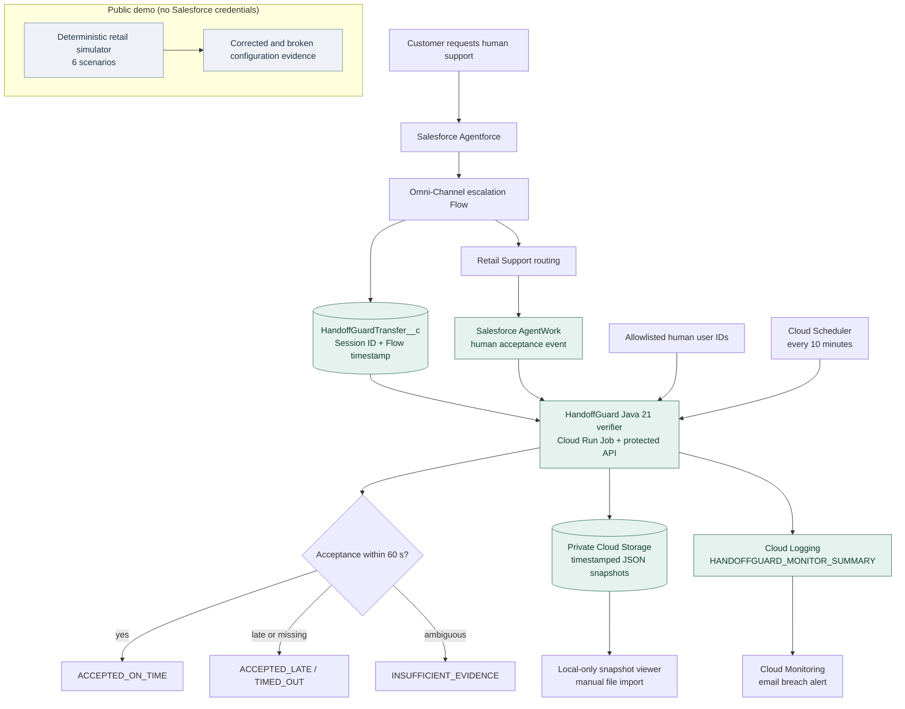

# HandoffGuard architecture

This diagram describes the deployed v1.0 control flow. The public deterministic simulator and the private Salesforce evidence path are **separate**.

## Trust and timing boundaries

- **The 60-second threshold is the acceptance SLA, not a guarantee of alert delivery latency.** The scheduler polls every ten minutes; end-to-end notification can take longer.
- **Provenance:** Salesforce Flow captures `$Flow.CurrentDateTime` at escalation; AgentWork supplies actual acceptance. The verifier excludes automated process users.
- **Correlation:** matching accepts Salesforce 15- and 18-character session IDs. Ambiguous multiple markers are not silently matched to a work event.
- **Data minimization:** no customer transcripts; snapshot viewer parses user-selected JSON locally; real Salesforce endpoints require an API key and must not be called from public JS.
- **Failure behavior:** the Flow's fault connector continues human routing if transfer-marker logging fails; missing evidence cannot be interpreted as a successful handoff.
- **Operational limitations:** monitoring scans recent markers with a cap, and alerts may repeat until sessions age out of that window.
